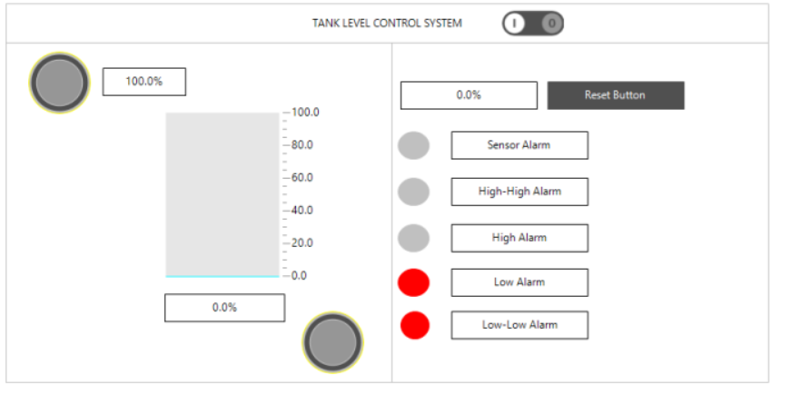

# Tank Level Control & Process Safety System

A PLC-based tank level control system developed in **CODESYS V3.5** using Structured Text (ST) and Ladder Diagram (LD).

The project simulates an industrial tank level control process with PID control, alarms, safety interlocks, pump feedback monitoring, and HMI visualization.

## Main Features

- PID-based automatic tank level control
- Automatic and manual operating modes
- High / High-High and Low / Low-Low level alarms
- Sensor fault detection
- Emergency stop and process safety interlocks
- Pump start feedback monitoring
- Automatic control valve safety closing
- CODESYS HMI visualization
- P&ID of the process

## PLC Program

The project uses a modular PLC structure with reusable Function Blocks:

- `FB_LevelControl` – PID control, alarms and sensor fault detection
- `FB_Pump` – pump control, interlocks and feedback monitoring
- `FB_ControlValve` – automatic/manual valve control and safety closing
- `DUT_Alarms` – alarm setpoints and alarm status
- `ACT_Interlock` – Ladder Diagram safety interlocks

## Safety Logic

The main protection functions include:

| Condition | Automatic Action |
|---|---|
| Level ≥ 90% | Inlet pump blocked and control valve closed |
| Level ≤ 10% | Outlet pump blocked |
| Sensor fault | Pumps blocked and control valve closed |
| Emergency stop | Pumps blocked and control valve closed |

## Process Diagram

The P&ID represents the main process equipment and instruments, including:

- TK-101 – Tank
- LT-101 – Level Transmitter
- LIC-101 – Level Controller
- P-101 – Inlet Pump
- P-102 – Outlet Pump
- CV-101 – Control Valve
- XES-101 – Emergency Stop

## HMI

The CODESYS visualization provides real-time tank level monitoring, setpoint display, alarm indications, and alarm reset control.

## Technologies

- CODESYS V3.5
- Structured Text (ST)
- Ladder Diagram (LD)
- PID Control
- PLC Function Blocks
- HMI / WebVisu
- P&ID

## Author

**Khazar Tarverdiyev**  
Process Automation Engineering Student  
Baku Engineering University

